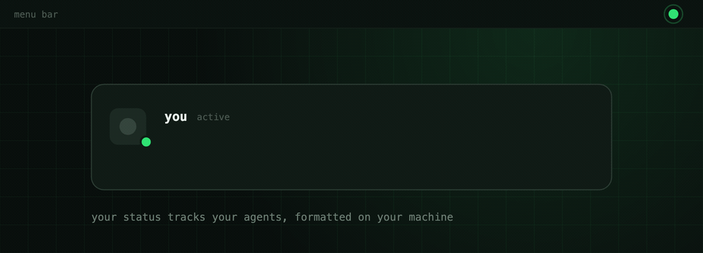

<div align="center">

<a href="https://agentblip.com"></a>

<p>
<a href="https://www.npmjs.com/package/@b3os/workmesh"></a>
<a href="https://github.com/b3-fun/workmesh/actions/workflows/ci.yml"></a>
<a href="LICENSE"></a>
</p>

<p><strong><a href="https://agentblip.com">agentblip.com</a> · <a href="https://www.npmjs.com/package/@b3os/workmesh">npm</a> · <a href="https://github.com/b3-fun/workmesh">GitHub</a></strong></p>



</div>

> Workmesh was called **agentblip** until 0.7. The `agentblip` command still works,
> and your config, pairings and hooks carry over: see [Upgrading from agentblip](#upgrading-from-agentblip).

## Your team can't see your agents

You kick off three Claude Code sessions, go heads-down reviewing what they produce,
and on Slack you look… idle. Meanwhile someone pings you mid-run, an agent sits blocked
on a permission prompt for twenty minutes, and nobody — including you — knows. Presence
used to mean "at the keyboard." Now half the work is delegated, and the green dot has
nothing to say about it.

Workmesh puts your local agent sessions where your team can see them. A small daemon on
your machine turns them into your Slack status, the little green light for the AI era,
and forwards what you choose to share to your team's board: every teammate's agents,
the repo and branch each one is in, and which ones wait on a person. It formats
everything on your machine (the Slack relay only ever sees the finished string), and a
rolling expiration means a dead daemon clears itself instead of lying.

| Your status reads | When |
|---|---|
| 🤖 `claude agent working` | one session busy |
| 🤖 `3 agents working` | three sessions busy |
| 🤖 `workmesh: finalizing CI/CD` | `activity` granularity — the repo and what it's doing |
| ✋ `1 agent(s) waiting on me` | an agent is blocked on you |

## Quick start

```bash
npm i -g @b3os/workmesh
workmesh init https://workmesh.b3os.org   # hooks, MCP tools, the daemon, pairing (approve in the browser)
```

`workmesh init <hub-url>` (0.11+) does the whole setup in one go and prints each step: it
installs or refreshes the agent hooks and the `workmesh` MCP server, runs the daemon (under
launchd / systemd when it can) and restarts it on the current build, then pairs this machine
with the hub, opening the browser to approve. Running it again is safe: hooks that are
already right stay as they are, and pairing is skipped while the hub still accepts this
machine (`--repair` pairs again). A machine paired under another address of the same hub
(`bullpen.b3os.org` before the rename) keeps its pairing and switches to the address you
gave. `--share conversation|metadata`, `--no-codex`, `--no-open`, `--machine <name>`,
`--claude-dir <path>`, `--no-mcp`, `--no-service`, `--no-linger` and `--no-wake` pass
through. The same steps by hand:

```bash
workmesh setup --hooks-only        # Claude Code hooks, plus Codex's if Codex is installed
workmesh start --detach            # the daemon, in the background
workmesh hub connect <url>         # join your team's board (approve in the browser)
```

`setup --hooks-only` hooks the Claude Code profile in `$CLAUDE_CONFIG_DIR`, else
`~/.claude`; `--claude-dir <path>` picks another. It hooks Codex only when it finds a
Codex install (`$CODEX_HOME` or `~/.codex`) and says so; `--no-codex` leaves Codex alone,
`--codex` installs it anyway. The `workmesh` MCP server is registered in the same
profiles (`--no-mcp` skips it). `workmesh uninstall` takes the hooks and the MCP server
out again, and removes the daemon service setup installed (`--no-service` keeps it).

It ends by checking that the hub heard from this machine: from then on you show as
online on the board, with "no agents running" until an agent works in a shared repo.
`workmesh doctor` says what is wrong when a machine shows offline, and what to run.

### Linux

`workmesh init` works the same on Linux, with Node 20, 22 or 24:

- **With systemd** (Ubuntu, Debian, Fedora, WSL with systemd) the daemon runs as a
  `systemd --user` unit, `~/.config/systemd/user/workmesh.service`. systemd stops your
  user services about 10 s after you log out of your last session, so on a box you SSH
  into, the daemon would stop when you leave and the board would show you offline.
  `init` turns on lingering for your user (`loginctl enable-linger`) so the daemon keeps
  running and starts at boot. Where only an admin may do that (no polkit, as on a minimal
  Debian), `init` offers to run `sudo loginctl enable-linger $USER` in the terminal, and
  prints it otherwise. `--no-linger` leaves lingering off. Undo with
  `loginctl disable-linger`.
- **Without systemd** (a container, WSL without systemd, a minimal VM) the daemon runs
  detached in the background and outlives the shell that started it. After a reboot the
  next agent hook starts it again.
- **`su`, `sudo -u` or cron shells** often lack `XDG_RUNTIME_DIR`; Workmesh finds your
  user manager at `/run/user/<uid>` anyway.
- Check it with `workmesh doctor`; it names the cause (`logout`, `daemon service`,
  `hub forward`) and the fix. `scripts/smoke-linux/smoke.sh` runs this whole path on
  fresh Linux boxes in Docker (Node 20/22/24, with and without systemd, over SSH).

Claude Code and Codex sessions appear automatically via their hooks (Codex also keeps
its notify hook and a session watcher as fallbacks). Anything else can report itself
with one HTTP request (see [Integrations](#integrations)).

For the Slack status too, run `workmesh setup` instead of `--hooks-only`: it pairs your
Slack workspace in the browser and asks how much your status may say. When every agent
finishes, your status clears.

## How it works

```
Claude Code hooks ─┐
Codex watcher ─────┤   POST /event      ┌────────────────────┐  POST /api/status   ┌──────────────┐
Any tool (curl) ───┼──────────────────▶ │ workmesh daemon    │ ───────────────────▶│ relay Worker │──▶ Slack API
                   │  localhost:4519    │ SessionStore →     │  pre-formatted      │ (or direct   │   users.profile.set
                   └                    │ formatStatus →sink │  SlackStatus only   │  Slack sink) │
                                        └────────────────────┘                     └──────────────┘
```

The daemon is the only thing that sees raw session data. Hooks and adapters report
events to `127.0.0.1:4519`; the daemon aggregates your sessions and formats the status
text **locally**, applying your granularity, templates, and redaction patterns before
anything touches the network. The relay receives exactly three fields — text, emoji,
expiration — and passes them to Slack's `users.profile.set`. It cannot see your
prompts, tool calls, file paths, or projects, because they never leave your machine
unless you chose a granularity that puts them in the status text itself. (At
`"presence"` the relay sees the same fixed string all day.)

Every push carries a rolling expiration (5 minutes by default). If your laptop sleeps,
the daemon crashes, or wifi drops, Slack clears the status on its own — no stale
"working" lies. Server-side, the relay stores nothing about you beyond your Slack
user/team ids and an AES-GCM-encrypted Slack token keyed to your device, and you can
revoke that any time with `workmesh unlink`.

## Granularity & customization

One knob controls how much your status reveals:

| `granularity` | Your status reads |
|---|---|
| `off` | never set |
| `presence` | 🤖 `heads down with agents` |
| `count` (default) | 🤖 `claude agent working` · 🤖 `3 agents working` |
| `activity` | 🤖 `claude: finalizing CI/CD` · 🤖 `3 agents · finalizing CI/CD` |

At `count` and `activity`, agents blocked on you append ` · 1 waiting on me`; when
nothing is working and agents are only waiting, the status flips to
✋ `1 agent(s) waiting on me`.

Everything lives in `~/.config/workmesh/config.json` (`XDG_CONFIG_HOME` respected),
created by `workmesh setup`. The comments below are documentation — the real file is
plain JSON:

```jsonc
{
  // How much your status reveals: "off" | "presence" | "count" | "activity".
  "granularity": "count",

  // Append the project name: "claude agent working (workmesh)".
  // Project is usually the basename of the session's cwd.
  "showProject": false,

  // In "activity" mode, lead with the repo name instead of the agent:
  // "b3iq: editing README.md" rather than "claude: editing README.md".
  // Falls back to the agent prefix when the session has no known repo.
  "repoPrefix": true,

  // What to do when a status Workmesh didn't set is already up:
  // "respect" (default) — never overwrite it; stand down until it clears.
  // "overwrite" — displace it once, remember it, restore it when sessions end.
  "statusPolicy": "respect",

  // Rolling expiration in seconds — Slack auto-clears the status if the daemon
  // stops refreshing it (sleep, crash, dead wifi). 0 = never expire.
  "statusTtlSec": 300,

  // Minimum ms between Slack pushes (users.profile.set allows ~50/min).
  "debounceMs": 10000,

  // Local daemon port (loopback only).
  "port": 4519,

  // Relay the daemon pushes through in relay mode. `workmesh setup` asks for
  // it at the "Relay URL" prompt (default https://agentblip.com), or takes it
  // via --relay-url. The WORKMESH_RELAY_URL env var overrides it at runtime
  // (so do WORKMESH_TOKEN, WORKMESH_PORT and WORKMESH_STATUS_POLICY; the old
  // AGENTBLIP_* names still work when the WORKMESH_* one is unset).
  "relayUrl": "https://agentblip.com",

  // Strings or regexes scrubbed from activity/project text before it can reach
  // your status. Case-insensitive; strings that don't compile as regexes match
  // literally. Matches become "…".
  "redactPatterns": ["secret-project", "client-\\w+"],

  // Project names to suppress entirely — sessions in these projects still count
  // toward "N agents working" but never contribute activity/project text.
  "hideProjects": ["acme-confidential"],

  // Status emoji, Slack ":name:" form.
  "emoji": { "working": ":robot_face:", "waiting": ":raised_hand:" },

  // Status text templates. Placeholders in {braces}; unknown ones are left as-is.
  "templates": {
    "presence": "heads down with agents",              // fixed text for "presence"
    "workingOne": "{agent} agent working",             // {agent} {activity} {project}
    "workingMany": "{working} agents working",         // {working} {total}
    "waitingSuffix": " · {waiting} waiting on me",     // {waiting} — appended while agents wait
    "activityOne": "{agent}: {activity}",              // {agent} {activity} {project}
    "activityMany": "{working} agents · {activity}",   // {working} {activity}
    "repoActivityOne": "{project}: {activity}",        // repoPrefix on: {project} {activity} {agent}
    "repoActivityMany": "{working} agents · {project}: {activity}", // repoPrefix on, multiple
    "waitingOnly": "{waiting} agent(s) waiting on me"  // {waiting} — nothing working, agents blocked
  },

  // Auto-start the daemon from a hook when it isn't already running (a failed
  // start is cooled down for 60s so a broken config can't respawn on every hook).
  "autoStartDaemon": true,

  // Which source adapters the daemon activates. Codex takes an optional
  // sessionsDir (defaults to ~/.codex/sessions); workflow watches Claude Code's
  // workflow journals for live agent counts (projectsDir defaults to
  // ~/.claude/projects).
  "adapters": {
    "claudeCode": { "enabled": true },
    "codex": { "enabled": true },
    "workflow": { "enabled": true }
  }
}
```

> The config block above must stay in sync with `configSchema` in
> `packages/cli/src/lib/config.ts` — that schema is the source of truth.

Status text is truncated to Slack's 100-character cap. `{agent}` is a friendly display
name (`claude-code` → `claude`, `codex` → `codex`, `gemini-cli` → `gemini`); unknown
sources display as-is.

## Plays nice with your status

Your status field isn't only Workmesh's. Before every push the daemon reads your
current Slack status (via the relay in relay mode, or straight from Slack in direct
mode — that's the `users.profile:read` scope) and decides what it's allowed to do:

- **`statusPolicy: "respect"` (default).** A status Workmesh didn't set — one you
  typed yourself, or another app's — is never overwritten. The daemon stands down
  (`workmesh status` shows it backing off) and resumes automatically the moment that
  status clears or expires.
- **`statusPolicy: "overwrite"`.** Workmesh displaces the existing status, remembers
  it, and puts it back when your sessions end.
- **A manual change mid-session always wins**, under either policy. If your status
  changes out from under Workmesh while it's active, that's you (or another app)
  speaking deliberately: the daemon backs off, treats the new status as the truth, and
  drops anything it had saved.

Honest edge cases: if the daemon dies mid-session, your status simply expires blank
after the rolling TTL (no stale "working" lies) — and a status Workmesh had displaced
under `"overwrite"` is restored the next time the daemon starts, unless it carried its
own expiration that has since passed. If your Slack token predates the read scope,
Workmesh can't see the current status and falls back to its old blind-push behavior;
re-authorize to get the new one:

```bash
workmesh unlink && workmesh setup
```

## Integrations

### Claude Code — automatic

`workmesh setup` installs hooks into your Claude Code settings: `<dir>/settings.json`,
where `<dir>` is `--claude-dir`, else `$CLAUDE_CONFIG_DIR`, else `~/.claude`. It merges:
other hooks and settings stay, and the file as it was is saved next to it as
`settings.json.workmesh-backup-<timestamp>` each time it changes. `workmesh uninstall`
(same `--claude-dir`) removes only Workmesh's entries. The daemon reads sessions and
workflow journals from the same dir (`adapters.claudeCode.configDir` in the config, set by
an interactive `setup --claude-dir`, else `$CLAUDE_CONFIG_DIR`, else `~/.claude`). Nine
hook events map onto the session lifecycle:

| Claude Code hook | Event sent |
|---|---|
| `SessionStart` | `start` |
| `UserPromptSubmit` | `working` |
| `PreToolUse` | `working` (tool as activity); `waiting` for `AskUserQuestion` / `ExitPlanMode` |
| `PostToolUse` | `working` (keeps liveness fresh) |
| `Notification` | `waiting` for permission prompts and dialogs; for the 60s idle reminder, see below |
| `Stop` | `idle` |
| `SessionEnd` | `end` |
| `SubagentStart` / `SubagentStop` | `heartbeat` (the session's state is unchanged; a team hub sees each subagent) |

Each hook pipes its JSON to `workmesh hook claude-code`, which forwards a normalized
event to the daemon. Multiple concurrent sessions just work — each is tracked by its
session id.

**What a hook costs.** Each hook is a short Node process that Claude Code waits for.
It always exits 0, so a Workmesh failure never fails a session; on a coordinating hub it
may refuse an edit to a teammate's leased file or a held session's tool call, or add a
note for the agent (see [Coordinate](#coordinate-leases-claims-messages-holds)), from
the daemon's cached state. A refused connection fails
at once; a hung daemon costs each hook up to 0.75 s; the one hook that starts a stopped
daemon waits up to 3 s for it, and hooks arriving meanwhile up to 1 s. After a failed
start, hooks don't try again for 60 s. The command pins the absolute Node path setup ran
with, because GUI-launched agents don't get your login `PATH`. If that Node comes from a
version manager (nvm, fnm, Volta, …), setup warns you: after you upgrade or remove that
version, run `workmesh setup --hooks-only` again. `workmesh doctor` fails if the pinned
Node is gone.

**"Waiting on me" means waiting on you.** Claude Code's idle reminder fires for every
finished turn left unanswered. Workmesh reads the end of the session transcript and
only counts it as waiting when the turn ended by asking you something (a question, "want
me to…", "needs your OK", an open `AskUserQuestion`). A session still running its own
background shells or subagents shows as working in the background; a turn that simply
finished ("When he replies, I'll run the release") goes idle. If the transcript can't be
read, it falls back to waiting.

**Crashed sessions clear themselves.** The daemon checks Claude Code's per-process
session files every 15 seconds. A session whose process is gone for two minutes without
a `SessionEnd` is ended, and a session Claude Code reports busy stays "working" through
one long tool call.

> **Subagents & workflows — automatic.** Hooks fire per session, so Claude Code can't
> tell Workmesh how many subagents a session fanned out into. For ultracode
> `Workflow` runs, Workmesh watches Claude Code's local workflow journals and reports
> the live agent count itself — a 5-agent workflow shows `🤖 5 agents · running a
> workflow` with no setup, and clears when it finishes. (Toggle: `adapters.workflow` in
> the config.) For other fan-outs — a `Task`-tool session, a CI matrix, a batch job —
> report it explicitly (see [Report a fan-out](#report-a-fan-out) below).

### Report a fan-out

When a session spawns many concurrent agents (an ultracode workflow, a CI matrix, a
batch job), let it self-report so the count is honest. `workmesh report` sets an
`agents` count and an optional `phase`, and `--done` clears it:

```bash
workmesh report --agents 5 --phase "verify" --activity "reviewing findings"
# → Slack: 🤖 5 agents · reviewing findings · verify
workmesh report --done      # fleet finished
```

The count sums with your real sessions (5 reported agents + 1 live Claude Code session
= "6 agents working"), and it auto-clears if the reporter goes quiet, so a crashed job
won't leave a stale "5 agents" lie. Any orchestrator that can run a shell command can
call it — a Makefile target, a CI step, or an agent step inside a workflow.

(Ultracode `Workflow` runs don't need this — the built-in workflow watcher already
reports them automatically.)

### Codex — hooks, with notify + watcher as fallbacks

`workmesh setup` merges its hooks into `~/.codex/hooks.json` (`$CODEX_HOME` respected,
here and for `config.toml` and the session logs) for `SessionStart`, `UserPromptSubmit`,
`PreToolUse`, `PermissionRequest`, `PostToolUse`, `Stop` and `SessionEnd`;
`workmesh hook codex-hooks` is the entrypoint. Other tools' entries are kept, and each
file is backed up with a timestamp before every change. `setup --hooks-only` does this
only when Codex is installed (or with `--codex`); `workmesh uninstall` removes Workmesh's
hooks and its `notify` line again. Codex maps like
Claude Code: `apply_patch` shows as "editing <file>", shell calls as "running
commands", and a question or an approval prompt as waiting on you.

Codex runs a new user hook only after you trust it: open Codex and run `/hooks` once
after setup.

The older `notify` hook (`workmesh hook codex`) stays installed for Codex builds
without hooks, and the daemon still watches Codex session logs to mark sessions
working.

### Anything else — one HTTP request

The daemon's localhost API is a stable public interface. Report any process as an
agent session:

```bash
curl -X POST http://127.0.0.1:4519/event \
  -H "authorization: Bearer $(cat ~/.local/state/workmesh/daemon.secret)" \
  -H "content-type: application/json" \
  -d '{
    "source": "my-tool",
    "sessionId": "run-42",
    "kind": "working",
    "activity": "backfilling embeddings",
    "project": "acme-api"
  }'
```

The daemon auto-generates that bearer secret (`0600`, `XDG_STATE_HOME`
respected); every endpoint except `GET /health` requires it.

Send `{"kind": "end"}` with the same `source` + `sessionId` when it finishes. Full
schema, event semantics, staleness rules, and adapter-writing guide:
[docs/INTEGRATIONS.md](docs/INTEGRATIONS.md).

## Team board

Slack shows *that* you have agents running. The team board shows your whole team's
agent sessions live: who is running what, in which repo and branch, which ones wait on
a person, and each tool call as one line. The daemon forwards what you choose to share
to the hub you pair with, next to (never instead of) the Slack status. B3's hosted hub
is at [workmesh.b3os.org](https://workmesh.b3os.org).

```bash
workmesh hub connect https://workmesh.b3os.org   # shows a code, opens the browser to approve, asks what to share
workmesh hub connect https://workmesh.b3os.org --share conversation   # or --share metadata
workmesh hub share conversation                 # change it any time (no argument: show it)
workmesh hub status                             # paired? sharing level, last send, queued, dropped, shared sessions
workmesh hub include ~/work/shared-notes        # also share this folder
workmesh hub exclude ~/work/acme-private        # never share this, whatever its remote
workmesh hub disconnect
```

**What is shared.** At pairing the hub sends a rule, e.g. "repos whose `origin`
contains `github.com/your-org/`". A session is shared once its working directory is
in such a repo (worktrees count as their main repo), or once it touches a file in one.
Sessions anywhere else send nothing. At `metadata`, a session started outside a shared
repo (an orchestrator in `~/Documents`) shares its state, prompts (as "sent a message",
no text), file events in shared repos, and shell commands that name a path inside one.
At `conversation` it sends its text too (see below).

**Once shared, a session stays shared.** By default a session that touched a shared repo
once is shared for the rest of its life: if an orchestrator in `~/src` reads one file in a
shared repo, every later prompt and reply in that session is sent, including work on
your personal repos. `workmesh hub exclude <dir>` only stops a folder from making a
session shared; it doesn't unshare one that already is. To share such sessions turn by
turn instead, run `workmesh hub sticky off`: a session whose working directory is outside
every shared repo then starts each turn unshared and is shared only by a turn that touches
a shared repo. That turn's prompt, which comes first, isn't sent. Sessions inside a
shared repo are unaffected. Or keep personal work in a separate session.

**Sharing levels.** Each machine picks one, at `hub connect` or later with `hub share`:

| Level | What leaves your machine |
|---|---|
| `metadata` | Session state and Workmesh's own activity label, tool names, repo-relative paths inside shared repos, `owner/name` and branch, the program and one subcommand of a shell command for a fixed allow list (`cargo test`, `git commit`, `gh pr`), issue ids for the configured keys (`B3-7166`), and PR links on shared repos. |
| `conversation` | All of the above, plus your prompts, the agent's text replies, a one-line description of each tool call (the Bash `description`, a web search query, a fetched URL's host, the skill or MCP server and tool name), and how long each turn took. |

**The default is `conversation`.** In a terminal `hub connect` asks, suggesting your
earlier choice, else the hub's default (`conversation` on B3's hub). Without a terminal
or `--share`, and for pairings from before sharing levels existed, it is `conversation`.
`hub connect`, `hub status` and `setup` print the active level. Pass `--share metadata`, or
run `workmesh hub share metadata` later, for metadata only. Conversation text comes from
every shared session, including one whose working directory is outside shared repos,
and only from the moment the session is shared: Workmesh starts reading the session
transcript at its current end, so nothing written earlier is ever sent.
Agent messages are read from the transcript (Claude Code's `transcript_path`, Codex's
rollout file; Codex threads kept only in its SQLite history fall back to the final
message of each turn), main thread only, never thinking, tool input or tool output.
Prompts and messages are capped at 4,000 characters.

**Redaction, on your machine.** Before anything is queued, every text field and tool
description goes through a redactor: API keys and tokens by prefix (Anthropic, OpenAI,
GitHub, Slack, AWS, npm, Linear, Stripe, Google, Hugging Face, Workmesh hub and relay
device tokens, and more), JWTs, PEM private keys, `Bearer`/`Basic` values and auth
headers, values of secret-named settings (`password=`, `API_KEY:`, `--token`), URLs with
credentials, webhooks, and long random strings become `[redacted]`; home paths become
`~/…`. Long bare hex values (48+ digits, unless labelled as a digest, commit or
checksum, or `0x…`), base64 containing `/`, and short letter-and-digit values after a
generic name (`key=`, `sig:`, `pass:`) are caught too. It is tested against a corpus of
realistic fake secrets, and against real agent text for false positives. It is a safety
net, not a guarantee: don't paste secrets into a session you share.

**What redaction doesn't catch.** It looks for secrets only. Customer names, email
addresses, phone numbers, IP addresses, internal hostnames, payment details, pasted Slack
or email threads, and the substance of private work in a prompt or reply are sent as
written at `conversation`. So are short secrets with no prefix and no label (a bare
`hunter2`), plain-word passwords after a label (`password: hunter`), and 32-digit hex
values. If your prompts carry that kind of material, use `metadata`.

**Never, at any level:** tool input or output, file contents, command arguments beyond
the allow-listed subcommand, environment variables, absolute paths, or anything from a
repo outside the sharing rule. Every request is built from strict schemas, so a field
outside the contract can't be sent.

The hook passes richer local-only detail (tool input, prompt) to the daemon over
loopback so it can make those decisions; that detail is never stored on a session, never
formatted into your Slack status, and never sent to the Workmesh relay.

Delivery: batched every second in requests under 256 KB, a full heartbeat every 30 s,
up to 5,000 events (16 MB) held while the hub is unreachable, `Retry-After` honored. If
the hub revokes the device (401) forwarding stops and `workmesh hub status` tells you
to pair again. A hub too old to accept conversation events still gets everything else.

### The hub

The hub is the hosted half of Workmesh: it pairs machines, keeps the roster and a 7-day
timeline, writes short summaries (now lines, turn summaries, waiting reasons, a "since
you looked" digest), and serves the board, a live web page of everyone's sessions with
each one's conversation a click away. B3 runs it at
[workmesh.b3os.org](https://workmesh.b3os.org) (`bullpen.b3os.org`, the hub's name
before it joined Workmesh, serves the same hub, so machines paired there keep sending).
People sign in to the board; relays reach `/relay/*` with their own device tokens.

The hosted platform is B3's and its code is private. Everything that runs on your
machine is here and open source, and so is the contract the relay and the hub share:
the wire format, what may leave a machine, sharing levels, redaction and the privacy
rules a hub keeps are in [docs/SPEC.md](docs/SPEC.md), and the schemas both sides
validate against are [`packages/protocol`](packages/protocol).

### Coordinate: leases, claims, messages, holds

On a hub that coordinates (Workmesh v1), your agents and your teammates' stop colliding:

- **Leases.** An agent leases the files it is about to rework (`lease` with paths,
  directories or globs such as `src/hub/**`; 30 minutes by default). Another session's
  edit to a leased file (Edit, Write, MultiEdit, NotebookEdit, Codex `apply_patch`, and
  shell commands that plainly write a path such as `rm`, `mv`, `sed -i`, `> file`) is
  refused before it runs, with who holds it, until when, and how to ask them. Your own
  other sessions count as other sessions: leases are about agents colliding.
- **Heads-ups.** Before an agent edits a file another person's agent edited in the last
  10 minutes, it is told who is working there (the edit goes ahead).
- **Claims.** An agent claims the Linear issue it works on; one claimant per issue.
- **Messages.** `send` reaches a person's agent (or a named agent) at its next tool call
  as "Message from An (b3iq-strategy): …"; `inbox` lists what is waiting.
- **Holds.** A teammate can hold one of your agents from the board or a Linear comment:
  its next tool call, and every one after, is refused with their reason until they lift
  it. The menu bar shows holds on your agents and messages waiting for them.
- **Notes.** Shared project notes every teammate's agent can read.

Agents get these as MCP tools (`workmesh mcp`, registered for Claude Code and Codex by
`workmesh setup`) and a short note at the start of each shared session; the same calls
work from a terminal (`workmesh leases`, `workmesh send An "…"`). The daemon answers
hooks from its last sync with the hub (every 5 s while a shared session runs), so a hook
makes no network call and takes no longer than before. **It fails open:** if the hub or
the daemon can't be reached, nothing is refused (a lease counts only while the last sync
is under 90 s old), except a hold the daemon already knew about, which stays in force for
up to 30 minutes until a sync confirms it was lifted. Lease paths, claimed issue ids and
the text of messages and notes you send (redacted first) go to the hub; nothing else
about your files does.

### Delegate: handoffs, approval gates, waking idle sessions

Since 0.11 (SPEC §30-31), on a hub that serves them (an older hub answers 404 and none of
this happens):

- **Handoffs.** An agent (the `handoff` MCP tool) or you (`workmesh handoff An "…" --repo
  b3-fun/x`) hand a task to a teammate, or to `me` for another of your machines. The
  recipient accepts it on the board or in their menu bar (`workmesh handoffs accept <id>`
  works too); their machine then starts a new agent for it: it finds its checkout of the
  repo (repos your sessions worked in, and dirs you name with `workmesh roots add ~/code`),
  makes a git worktree on a fresh `workmesh/handoff-…` branch from the default branch (your
  working tree is never touched), and runs `claude -p` (or `codex exec`) there in the
  background. The session is shared like any other in that repo, so it shows on the board,
  linked to the handoff; when it ends the hub hears `done` or `failed` with a short note,
  and the sender's agent is told. Which handoffs run without a click is your policy,
  `workmesh handoffs policy`: `auto-self` (the default: ones you send yourself run at once on
  one of your machines; teammates' wait for your Accept), `ask` (all wait) or `never`.
- **Approval gates.** `workmesh gates set merge,deploy` makes your own agents ask before they
  merge a PR, deploy, publish, force-push or spend (`workmesh gates off` turns them off;
  nothing is gated until you opt in). A gated shell command (`gh pr merge 212`, `wrangler
  deploy`, `npm publish`, `git push --force`, …) is held with "Waiting for Sean's approval
  to merge (gh pr merge 212 --merge in b3-fun/b3os-beta)", and the board, your menu bar and
  `workmesh approvals` show it to approve or deny. The agent is told the decision. Agents
  can't set gates or decide approvals. Gates fail open: when the hub can't be reached, or
  the request doesn't reach it, the command runs. Only the few words naming the action
  leave your machine, and only for actions you gated.
- **Waking idle sessions.** A message for a session that sits idle (a teammate's message, an
  approval decided, a handoff finished) wakes it: in Claude Code through an `asyncRewake`
  Stop hook that waits for the session's next message (Claude Code 2.1.330+), in Codex
  through `codex queue`. A message from an agent waits for the next turn unless its sender
  asks to wake. `workmesh wake off` turns it off.
- **Team knowledge.** The note at the start of each shared session also carries the
  project's notes tagged `rule` or `convention` (`workmesh note "…" --tag rule`) and your
  open claims.

### What the hub stores, and open questions

> **To be filled in by Sean.** The hub's code is private, so this section can't be checked
> against code from this repo. The list below comes from the wire contract and
> [docs/SPEC.md](docs/SPEC.md#privacy-rules); the questions need an answer from the
> hub's owner.

What the hub receives and keeps, by the contract:

- **Per device:** the device id, the machine name, the person from pairing (name and
  email), their GitHub login (from `gh`), and the sharing level.
- **Per session:** state, activity label, repo (`owner/name`), branch, repo-relative
  paths, issue ids, PR links, subagent structure, model and token counts.
- **At `conversation`:** prompt text, the agent's text replies, one-line tool
  descriptions, turn durations, messages agents send each other, Slack links agents
  posted or read, and the summaries the hub writes from that text (now lines, turn
  summaries, waiting reasons, digests), which may be generated by a language model
  (SPEC: OpenRouter, else Cloudflare Workers AI).
- **Retention and access, as SPEC states them:** events are kept 7 days and shown to
  the project's signed-in members (on B3's hub, npclabs.org logins through Cloudflare
  Access). Switching to `metadata` deletes that device's stored text.

Open questions:

- **Who can read conversation text?** Every signed-in member of the project, or only
  some (the person, their team, admins)? Can anyone outside the project see it, such
  as Cloudflare Access admins or hub operators reading storage directly?
- **Retention beyond 7 days.** Does the 7-day limit cover summaries, digests, Durable
  Object storage, backups and logs too? What does the language-model provider keep
  from the text it summarizes?
- **Deleting your own data.** Can a person delete one session, or all their text,
  without switching the whole machine to `metadata`? What happens to a device's data
  after `hub disconnect` or revoking it on the board?
- **Audit.** Is there a record of who viewed a session's conversation?

## CLI reference

| Command | Does |
|---|---|
| `workmesh init <hub-url>` | One-step setup for a team hub: hooks and MCP tools, the daemon (restarted on this build), pairing; safe to run again (`--share`, `--no-codex`, `--no-open`, `--machine`, `--claude-dir`, `--no-mcp`, `--no-service`, `--no-wake`, `--repair`) |
| `workmesh setup` | Interactive setup: pick a mode (relay / slack / console) + install agent hooks. Relay mode prompts for the Relay URL (default `https://agentblip.com` — enter your own domain to self-host); `--relay-url <url>` skips the prompt; `--hooks-only` just installs or refreshes the hooks and the `workmesh` MCP server (`--no-mcp` skips it); `--claude-dir <path>` picks the Claude Code profile (default `$CLAUDE_CONFIG_DIR`, else `~/.claude`); `--codex` / `--no-codex` decide about Codex (default: only when installed) |
| `workmesh uninstall` | Remove Workmesh's hooks and MCP server from Claude Code (`settings.json`, `.claude.json`) and Codex (`hooks.json`, `config.toml`), keeping everything else, and its launchd / systemd daemon service (which stops the daemon it ran); backs up each file first (`--claude-dir <path>`, `--no-codex`, `--no-service`) |
| `workmesh start [--detach]` | Run the daemon, foreground or in the background |
| `workmesh stop` | Stop the background daemon; returns once it has exited (SIGKILL after 5 s). Also stops a daemon started before the rename |
| `workmesh restart` | Stop the daemon, wait for it to exit, and start it again in the background |
| `workmesh status [--json]` | Show daemon state, live sessions, and the current status |
| `workmesh emit` | Send a session event by hand (testing, scripts) |
| `workmesh report` | Report a fan-out of concurrent agents (`--agents N --phase X`, `--done`) so "N agents working" is accurate |
| `workmesh hook <source>` | stdin→event adapter wired into agent hooks (`claude-code`, `codex-hooks`, `codex` for notify) |
| `workmesh pause [--for 30m\|1h\|tomorrow]` | Pause Slack updates without stopping the daemon; `--for` snoozes and resumes on its own (`tomorrow` = 9 AM) |
| `workmesh resume` | Resume Slack updates |
| `workmesh unlink` | Revoke this device's token and clear the status |
| `workmesh hub connect <url>` | Pair this machine with a team hub (device code; `--share conversation\|metadata`, `--no-open`, `--machine <name>`) |
| `workmesh hub share [level]` | Show or set what this machine shares: `conversation` or `metadata` |
| `workmesh hub sticky [on\|off]` | Show or set whether a session stays shared after it touches a shared repo (`on`, the default) or is shared turn by turn (`off`) |
| `workmesh hub status [--json]` | Pairing, sharing level, project, last send, queued/dropped events, shared sessions |
| `workmesh hub include <dir>` / `exclude <dir>` | Share a folder too / never share a folder |
| `workmesh hub disconnect` | Stop forwarding and remove the hub token |
| `workmesh leases [--repo owner/name]` | Active file leases on your team: who holds which paths, for how long |
| `workmesh lease <paths...>` / `unlease [paths...]` | Lease files, directories or globs for the agent session it runs in (`--reason`, `--minutes`); release them |
| `workmesh claims` / `claim <issue> [--release]` | Linear issues your team's agents claimed; claim or release one |
| `workmesh send <to> <text...>` | Message a person (name, email or GitHub login) or an agent (session name); delivered at its next tool call |
| `workmesh inbox` | Messages waiting for this machine's agents (inside an agent session: for that session) |
| `workmesh note <text...>` / `notes` | Leave a note every teammate's agent can read; list the newest |
| `workmesh whoami` | Your person on the hub, and which agent session a command speaks for |
| `workmesh handoff <to> <task...>` | Hand a task to a teammate or `me` (`--repo`, `--issue`, `--context`); their machine starts an agent once they accept |
| `workmesh handoffs [accept\|decline <id>]` | Handoffs offered to you and sent by you; accept or decline one (`--note`) |
| `workmesh handoffs policy [auto-self\|ask\|never]` | Which handoffs this machine runs without a click |
| `workmesh roots [add\|remove <dir>]` | Where your repos live, for handoffs |
| `workmesh gates [set <list>\|off]` | Approval gates on your own agents: `merge`, `deploy`, `publish`, `force_push`, `spend`, `custom` |
| `workmesh approvals [approve\|deny <id>]` | Approvals your agents asked for, and ones you may decide (`--note`) |
| `workmesh wake [on\|off]` | Whether an idle session wakes for its messages (default on) |
| `workmesh mcp` | The coordination tools as an MCP server (stdio); `workmesh setup` registers it with Claude Code (user scope) and Codex |
| `workmesh doctor [--json]` | Diagnose config, daemon, hooks (`--claude-dir <path>` for another profile; fails when a hook's Node binary is gone), MCP registration, hub forward, coordination, and connectivity |

## Menu bar app (macOS)

A tiny native SwiftUI menu bar app puts the blip on your own screen. The icon is
calm while agents work and turns orange only when one needs you. The dropdown
shows your sessions grouped into Needs you, Working, Background and Idle, with
the project, what each is doing, its session name and how long it has been in
that state. Click a row to copy its name, reveal its folder or dismiss it. Snooze
Slack sync for 30 minutes, an hour or until tomorrow, and change the detail level
and own-status policy live. It's a thin client of the daemon (holds no logic of
its own), so nothing duplicates the core.

```bash
cd apps/menubar && ./scripts/make-app.sh 0.3.0 && open dist/Workmesh.app
```

Requires macOS 13+ and the daemon running. See [`apps/menubar/`](apps/menubar/README.md).

## Self-hosting & direct mode

The relay is one Cloudflare Worker with one KV namespace — fork the repo, create the
namespace and two secrets, deploy, and point the CLI at your own domain with
`workmesh setup --relay-url https://your.domain` (or enter it at the Relay URL
prompt). The full walkthrough is in [docs/SELF_HOSTING.md](docs/SELF_HOSTING.md). If you'd rather
run no server at all, direct mode has the daemon call Slack's API straight from your
machine with your own Slack app's user token — no relay in the loop.

## Upgrading from agentblip

Workmesh is agentblip, renamed. Moving over keeps everything:

- **Config and state.** The first `workmesh` command copies `~/.config/agentblip/config.json`
  (your Slack and hub pairings, sharing level, settings), `daemon.secret` and
  `ownership.json` to `~/.config/workmesh` and `~/.local/state/workmesh`, with the same
  `0600` permissions. The old files stay where they were as a backup. While
  `~/.local/state/agentblip` exists, the daemon keeps its secret there too, so tools
  that still read the old path keep working.
- **Hooks.** `workmesh setup --hooks-only` repoints the Claude Code and Codex hooks
  that an agentblip install wrote (by npm package, checkout path or bare command) to
  this install, in place, without duplicating them. Backups end in
  `.workmesh-backup-<timestamp>`, a new one before each change.
- **Daemon.** `workmesh restart` stops a daemon started by agentblip as well, then
  starts the new one.
- **Env vars.** `WORKMESH_*`; `AGENTBLIP_*` still read as fallbacks.
- **Command.** `agentblip` stays as an alias of `workmesh`.
- **Menu bar app.** `Workmesh.app` (bundle id `org.npclabs.workmesh.menubar`)
  replaces `agentblip.app`; if you start it at login with a LaunchAgent, point that at
  the new app.

## Contributing

PRs welcome — see [CONTRIBUTING.md](CONTRIBUTING.md) for dev setup, the repo map, and
what a good PR looks like. The one hard rule: the relay must never see anything beyond
the final formatted status.

## License

MIT © 2026 [Sean Geng](https://seangeng.com)
