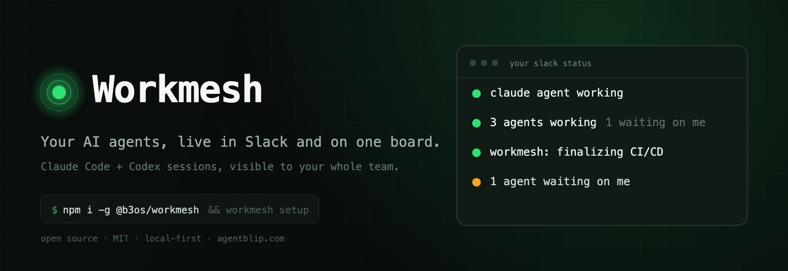

<div align="center">

<a href="https://agentblip.com"></a>

<p>
<a href="https://www.npmjs.com/package/agentblip"></a>
<a href="https://github.com/seangeng/agentblip/actions/workflows/ci.yml"></a>
<a href="LICENSE"></a>
</p>

<p><strong><a href="https://agentblip.com">agentblip.com</a> · <a href="https://www.npmjs.com/package/agentblip">npm</a> · <a href="https://github.com/seangeng/agentblip">GitHub</a></strong></p>


</div>

## Your team can't see your agents

You kick off three Claude Code sessions, go heads-down reviewing what they produce,
and on Slack you look… idle. Meanwhile someone pings you mid-run, an agent sits blocked
on a permission prompt for twenty minutes, and nobody — including you — knows. Presence
used to mean "at the keyboard." Now half the work is delegated, and the green dot has
nothing to say about it.

agentblip turns local agent sessions into your Slack status — the little green light
for the AI era. It formats everything on your machine (the relay only ever sees the
finished string), and a rolling expiration means a dead daemon clears itself instead
of lying.

| Your status reads | When |
|---|---|
| 🤖 `claude agent working` | one session busy |
| 🤖 `3 agents working` | three sessions busy |
| 🤖 `agentblip: finalizing CI/CD` | `activity` granularity — the repo and what it's doing |
| ✋ `1 agent(s) waiting on me` | an agent is blocked on you |

## Quick start

```bash
npm i -g agentblip
agentblip setup           # walks through Slack connect + hook install
agentblip start --detach  # daemon runs in the background
```

That's it. Claude Code and Codex sessions appear automatically via their hooks (Codex
also keeps its notify hook and a session watcher as fallbacks). Anything else can report itself with one HTTP request
(see [Integrations](#integrations)). When every agent finishes, your status clears.

## How it works

```
Claude Code hooks ─┐
Codex watcher ─────┤   POST /event      ┌────────────────────┐  POST /api/status   ┌──────────────┐
Any tool (curl) ───┼──────────────────▶ │ agentblip daemon   │ ───────────────────▶│ relay Worker │──▶ Slack API
                   │  localhost:4519    │ SessionStore →     │  pre-formatted      │ (or direct   │   users.profile.set
                   └                    │ formatStatus →sink │  SlackStatus only   │  Slack sink) │
                                        └────────────────────┘                     └──────────────┘
```

The daemon is the only thing that sees raw session data. Hooks and adapters report
events to `127.0.0.1:4519`; the daemon aggregates your sessions and formats the status
text **locally**, applying your granularity, templates, and redaction patterns before
anything touches the network. The relay receives exactly three fields — text, emoji,
expiration — and passes them to Slack's `users.profile.set`. It cannot see your
prompts, tool calls, file paths, or projects, because they never leave your machine
unless you chose a granularity that puts them in the status text itself. (At
`"presence"` the relay sees the same fixed string all day.)

Every push carries a rolling expiration (5 minutes by default). If your laptop sleeps,
the daemon crashes, or wifi drops, Slack clears the status on its own — no stale
"working" lies. Server-side, the relay stores nothing about you beyond your Slack
user/team ids and an AES-GCM-encrypted Slack token keyed to your device, and you can
revoke that any time with `agentblip unlink`.

## Granularity & customization

One knob controls how much your status reveals:

| `granularity` | Your status reads |
|---|---|
| `off` | never set |
| `presence` | 🤖 `heads down with agents` |
| `count` (default) | 🤖 `claude agent working` · 🤖 `3 agents working` |
| `activity` | 🤖 `claude: finalizing CI/CD` · 🤖 `3 agents · finalizing CI/CD` |

At `count` and `activity`, agents blocked on you append ` · 1 waiting on me`; when
nothing is working and agents are only waiting, the status flips to
✋ `1 agent(s) waiting on me`.

Everything lives in `~/.config/agentblip/config.json` (`XDG_CONFIG_HOME` respected),
created by `agentblip setup`. The comments below are documentation — the real file is
plain JSON:

```jsonc
{
  // How much your status reveals: "off" | "presence" | "count" | "activity".
  "granularity": "count",

  // Append the project name: "claude agent working (agentblip)".
  // Project is usually the basename of the session's cwd.
  "showProject": false,

  // In "activity" mode, lead with the repo name instead of the agent:
  // "b3iq: editing README.md" rather than "claude: editing README.md".
  // Falls back to the agent prefix when the session has no known repo.
  "repoPrefix": true,

  // What to do when a status agentblip didn't set is already up:
  // "respect" (default) — never overwrite it; stand down until it clears.
  // "overwrite" — displace it once, remember it, restore it when sessions end.
  "statusPolicy": "respect",

  // Rolling expiration in seconds — Slack auto-clears the status if the daemon
  // stops refreshing it (sleep, crash, dead wifi). 0 = never expire.
  "statusTtlSec": 300,

  // Minimum ms between Slack pushes (users.profile.set allows ~50/min).
  "debounceMs": 10000,

  // Local daemon port (loopback only).
  "port": 4519,

  // Relay the daemon pushes through in relay mode. `agentblip setup` asks for
  // it at the "Relay URL" prompt (default https://agentblip.com), or takes it
  // via --relay-url. The AGENTBLIP_RELAY_URL env var overrides it at runtime.
  "relayUrl": "https://agentblip.com",

  // Strings or regexes scrubbed from activity/project text before it can reach
  // your status. Case-insensitive; strings that don't compile as regexes match
  // literally. Matches become "…".
  "redactPatterns": ["secret-project", "client-\\w+"],

  // Project names to suppress entirely — sessions in these projects still count
  // toward "N agents working" but never contribute activity/project text.
  "hideProjects": ["acme-confidential"],

  // Status emoji, Slack ":name:" form.
  "emoji": { "working": ":robot_face:", "waiting": ":raised_hand:" },

  // Status text templates. Placeholders in {braces}; unknown ones are left as-is.
  "templates": {
    "presence": "heads down with agents",              // fixed text for "presence"
    "workingOne": "{agent} agent working",             // {agent} {activity} {project}
    "workingMany": "{working} agents working",         // {working} {total}
    "waitingSuffix": " · {waiting} waiting on me",     // {waiting} — appended while agents wait
    "activityOne": "{agent}: {activity}",              // {agent} {activity} {project}
    "activityMany": "{working} agents · {activity}",   // {working} {activity}
    "repoActivityOne": "{project}: {activity}",        // repoPrefix on: {project} {activity} {agent}
    "repoActivityMany": "{working} agents · {project}: {activity}", // repoPrefix on, multiple
    "waitingOnly": "{waiting} agent(s) waiting on me"  // {waiting} — nothing working, agents blocked
  },

  // Auto-start the daemon from a hook when it isn't already running (a failed
  // start is cooled down for 60s so a broken config can't respawn on every hook).
  "autoStartDaemon": true,

  // Which source adapters the daemon activates. Codex takes an optional
  // sessionsDir (defaults to ~/.codex/sessions); workflow watches Claude Code's
  // workflow journals for live agent counts (projectsDir defaults to
  // ~/.claude/projects).
  "adapters": {
    "claudeCode": { "enabled": true },
    "codex": { "enabled": true },
    "workflow": { "enabled": true }
  }
}
```

> The config block above must stay in sync with `configSchema` in
> `packages/cli/src/lib/config.ts` — that schema is the source of truth.

Status text is truncated to Slack's 100-character cap. `{agent}` is a friendly display
name (`claude-code` → `claude`, `codex` → `codex`, `gemini-cli` → `gemini`); unknown
sources display as-is.

## Plays nice with your status

Your status field isn't only agentblip's. Before every push the daemon reads your
current Slack status (via the relay in relay mode, or straight from Slack in direct
mode — that's the `users.profile:read` scope) and decides what it's allowed to do:

- **`statusPolicy: "respect"` (default).** A status agentblip didn't set — one you
  typed yourself, or another app's — is never overwritten. The daemon stands down
  (`agentblip status` shows it backing off) and resumes automatically the moment that
  status clears or expires.
- **`statusPolicy: "overwrite"`.** agentblip displaces the existing status, remembers
  it, and puts it back when your sessions end.
- **A manual change mid-session always wins**, under either policy. If your status
  changes out from under agentblip while it's active, that's you (or another app)
  speaking deliberately: the daemon backs off, treats the new status as the truth, and
  drops anything it had saved.

Honest edge cases: if the daemon dies mid-session, your status simply expires blank
after the rolling TTL (no stale "working" lies) — and a status agentblip had displaced
under `"overwrite"` is restored the next time the daemon starts, unless it carried its
own expiration that has since passed. If your Slack token predates the read scope,
agentblip can't see the current status and falls back to its old blind-push behavior;
re-authorize to get the new one:

```bash
agentblip unlink && agentblip setup
```

## Integrations

### Claude Code — automatic

`agentblip setup` installs hooks into your Claude Code settings. Seven hook events map
onto the session lifecycle:

| Claude Code hook | Event sent |
|---|---|
| `SessionStart` | `start` |
| `UserPromptSubmit` | `working` |
| `PreToolUse` | `working` (tool as activity); `waiting` for `AskUserQuestion` / `ExitPlanMode` |
| `PostToolUse` | `working` (keeps liveness fresh) |
| `Notification` | `waiting` for permission prompts and dialogs; for the 60s idle reminder, see below |
| `Stop` | `idle` |
| `SessionEnd` | `end` |

Each hook pipes its JSON to `agentblip hook claude-code`, which forwards a normalized
event to the daemon. Multiple concurrent sessions just work — each is tracked by its
session id.

**"Waiting on me" means waiting on you.** Claude Code's idle reminder fires for every
finished turn left unanswered. agentblip reads the end of the session transcript and
only counts it as waiting when the turn ended by asking you something (a question, "want
me to…", "needs your OK", an open `AskUserQuestion`). A session still running its own
background shells or subagents shows as working in the background; a turn that simply
finished ("When he replies, I'll run the release") goes idle. If the transcript can't be
read, it falls back to waiting.

**Crashed sessions clear themselves.** The daemon checks Claude Code's per-process
session files every 15 seconds. A session whose process is gone for two minutes without
a `SessionEnd` is ended, and a session Claude Code reports busy stays "working" through
one long tool call.

> **Subagents & workflows — automatic.** Hooks fire per session, so Claude Code can't
> tell agentblip how many subagents a session fanned out into. For ultracode
> `Workflow` runs, agentblip watches Claude Code's local workflow journals and reports
> the live agent count itself — a 5-agent workflow shows `🤖 5 agents · running a
> workflow` with no setup, and clears when it finishes. (Toggle: `adapters.workflow` in
> the config.) For other fan-outs — a `Task`-tool session, a CI matrix, a batch job —
> report it explicitly (see [Report a fan-out](#report-a-fan-out) below).

### Report a fan-out

When a session spawns many concurrent agents (an ultracode workflow, a CI matrix, a
batch job), let it self-report so the count is honest. `agentblip report` sets an
`agents` count and an optional `phase`, and `--done` clears it:

```bash
agentblip report --agents 5 --phase "verify" --activity "reviewing findings"
# → Slack: 🤖 5 agents · reviewing findings · verify
agentblip report --done      # fleet finished
```

The count sums with your real sessions (5 reported agents + 1 live Claude Code session
= "6 agents working"), and it auto-clears if the reporter goes quiet, so a crashed job
won't leave a stale "5 agents" lie. Any orchestrator that can run a shell command can
call it — a Makefile target, a CI step, or an agent step inside a workflow.

(Ultracode `Workflow` runs don't need this — the built-in workflow watcher already
reports them automatically.)

### Codex — hooks, with notify + watcher as fallbacks

`agentblip setup` merges agentblip into `~/.codex/hooks.json` (`$CODEX_HOME` respected)
for `SessionStart`, `UserPromptSubmit`, `PreToolUse`, `PermissionRequest`,
`PostToolUse`, `Stop` and `SessionEnd`; `agentblip hook codex-hooks` is the entrypoint.
Other tools' entries are kept, and the original file is backed up once. Codex maps like
Claude Code: `apply_patch` shows as "editing <file>", shell calls as "running
commands", and a question or an approval prompt as waiting on you.

Codex runs a new user hook only after you trust it: open Codex and run `/hooks` once
after setup.

The older `notify` hook (`agentblip hook codex`) stays installed for Codex builds
without hooks, and the daemon still watches Codex session logs to mark sessions
working.

### Anything else — one HTTP request

The daemon's localhost API is a stable public interface. Report any process as an
agent session:

```bash
curl -X POST http://127.0.0.1:4519/event \
  -H "authorization: Bearer $(cat ~/.local/state/agentblip/daemon.secret)" \
  -H "content-type: application/json" \
  -d '{
    "source": "my-tool",
    "sessionId": "run-42",
    "kind": "working",
    "activity": "backfilling embeddings",
    "project": "acme-api"
  }'
```

The daemon auto-generates that bearer secret (`0600`, `XDG_STATE_HOME`
respected); every endpoint except `GET /health` requires it.

Send `{"kind": "end"}` with the same `source` + `sessionId` when it finishes. Full
schema, event semantics, staleness rules, and adapter-writing guide:
[docs/INTEGRATIONS.md](docs/INTEGRATIONS.md).

## Hub forward (team board)

Slack shows *that* you have agents running. A hub shows your whole team's agent
sessions on one live board: who is running what, in which repo and branch, which ones
wait on a person, and each tool call as one line. agentblip is the relay: the daemon
forwards a small set of metadata to a hub you pair with, next to (never instead of)
the Slack status. [Bullpen](https://bullpen.b3os.org) is the first hub.

```bash
agentblip hub connect https://bullpen.b3os.org   # shows a code, opens the browser to approve
agentblip hub status                             # paired? last send, queued, dropped, shared sessions
agentblip hub include ~/work/shared-notes        # also share this folder
agentblip hub exclude ~/work/acme-private        # never share this, whatever its remote
agentblip hub disconnect
```

**What is shared.** At pairing the hub sends a rule, e.g. "repos whose `origin`
contains `github.com/your-org/`". A session is shared once its working directory is
in such a repo (worktrees count as their main repo), or once it touches a file in one.
Sessions anywhere else send nothing. A session started outside a shared repo (an
orchestrator in `~/Documents`) shares its state, prompts (as "sent a message", no
text), file events in shared repos, and shell commands that name a path inside one.

**What leaves your machine.** Only: session state and agentblip's own activity label,
tool names, repo-relative paths inside shared repos, `owner/name` and branch, the
program and one subcommand of a shell command for a fixed allow list (`cargo test`,
`git commit`, `gh pr`), issue ids for the configured keys (`B3-7166`), and PR links on
shared repos. Never prompt text, assistant text, tool input or output, file contents,
command arguments, environment variables or absolute paths. Every request is built
from strict schemas, so a field outside that list can't be sent.

The hook passes richer local-only detail (tool input, prompt) to the daemon over
loopback so it can make those decisions; that detail is never stored on a session, never
formatted into your Slack status, and never sent to the agentblip relay.

Delivery: batched every second, a full heartbeat every 30 s, up to 5,000 events held
while the hub is unreachable, `Retry-After` honored. If the hub revokes the device
(401) forwarding stops and `agentblip hub status` tells you to pair again.

## CLI reference

| Command | Does |
|---|---|
| `agentblip setup` | Interactive setup: pick a mode (relay / slack / console) + install agent hooks. Relay mode prompts for the Relay URL (default `https://agentblip.com` — enter your own domain to self-host); `--relay-url <url>` skips the prompt; `--hooks-only` just installs or refreshes the Claude Code and Codex hooks |
| `agentblip start [--detach]` | Run the daemon, foreground or in the background |
| `agentblip stop` | Stop the background daemon |
| `agentblip status [--json]` | Show daemon state, live sessions, and the current status |
| `agentblip emit` | Send a session event by hand (testing, scripts) |
| `agentblip report` | Report a fan-out of concurrent agents (`--agents N --phase X`, `--done`) so "N agents working" is accurate |
| `agentblip hook <source>` | stdin→event adapter wired into agent hooks (`claude-code`, `codex-hooks`, `codex` for notify) |
| `agentblip pause [--for 30m\|1h\|tomorrow]` | Pause Slack updates without stopping the daemon; `--for` snoozes and resumes on its own (`tomorrow` = 9 AM) |
| `agentblip resume` | Resume Slack updates |
| `agentblip unlink` | Revoke this device's token and clear the status |
| `agentblip hub connect <url>` | Pair this machine with a team hub (device code; `--no-open`, `--machine <name>`) |
| `agentblip hub status [--json]` | Pairing, project, last send, queued/dropped events, shared sessions |
| `agentblip hub include <dir>` / `exclude <dir>` | Share a folder too / never share a folder |
| `agentblip hub disconnect` | Stop forwarding and remove the hub token |
| `agentblip doctor [--json]` | Diagnose config, daemon, hooks, hub forward, and connectivity |

## Menu bar app (macOS)

A tiny native SwiftUI menu bar app puts the blip on your own screen. The icon is
calm while agents work and turns orange only when one needs you. The dropdown
shows your sessions grouped into Needs you, Working, Background and Idle, with
the project, what each is doing, its session name and how long it has been in
that state. Click a row to copy its name, reveal its folder or dismiss it. Snooze
Slack sync for 30 minutes, an hour or until tomorrow, and change the detail level
and own-status policy live. It's a thin client of the daemon (holds no logic of
its own), so nothing duplicates the core.

```bash
cd apps/menubar && ./scripts/make-app.sh 0.2.0 && open dist/agentblip.app
```

Requires macOS 13+ and the daemon running. See [`apps/menubar/`](apps/menubar/README.md).

## Self-hosting & direct mode

The relay is one Cloudflare Worker with one KV namespace — fork the repo, create the
namespace and two secrets, deploy, and point the CLI at your own domain with
`agentblip setup --relay-url https://your.domain` (or enter it at the Relay URL
prompt). The full walkthrough is in [docs/SELF_HOSTING.md](docs/SELF_HOSTING.md). If you'd rather
run no server at all, direct mode has the daemon call Slack's API straight from your
machine with your own Slack app's user token — no relay in the loop.

## Contributing

PRs welcome — see [CONTRIBUTING.md](CONTRIBUTING.md) for dev setup, the repo map, and
what a good PR looks like. The one hard rule: the relay must never see anything beyond
the final formatted status.

## License

MIT © 2026 [Sean Geng](https://seangeng.com)
